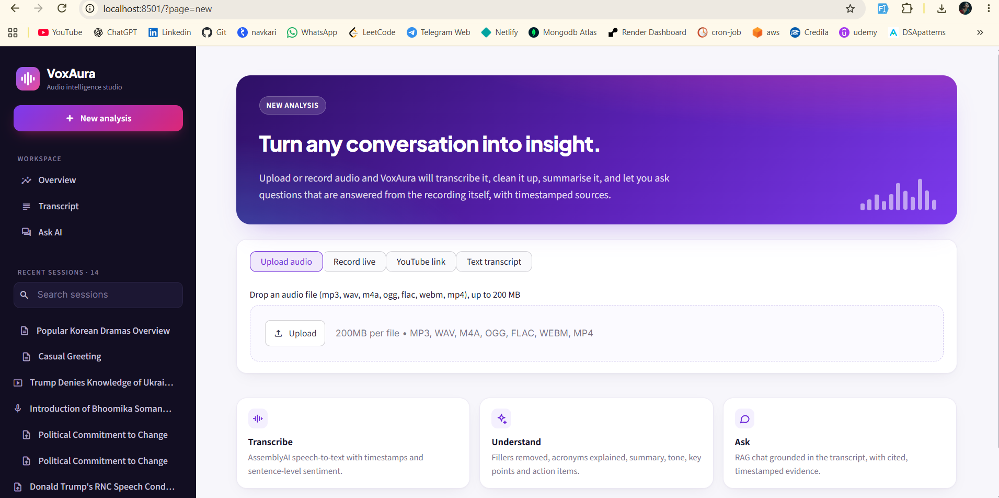
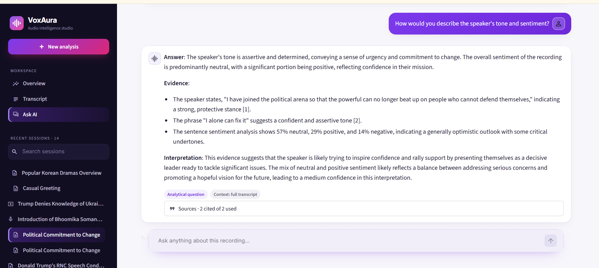
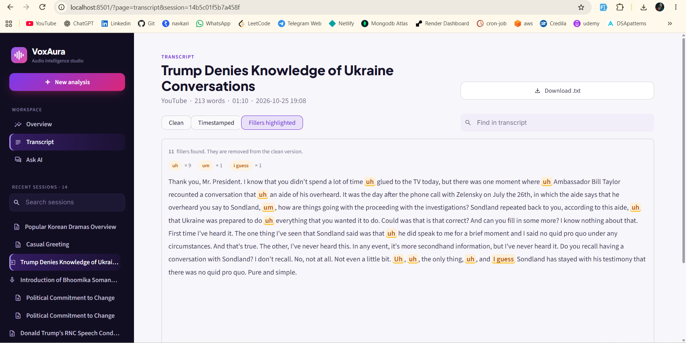
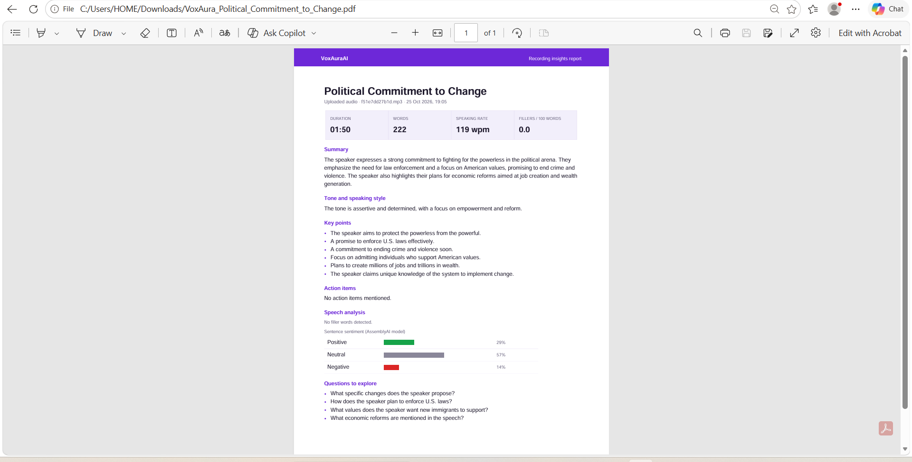

# 🔉 VoxAuraAI — AI-Powered Audio Understanding and Conversation

> **B.Tech final-year project** · Python · Generative AI · RAG · Streamlit

VoxAuraAI turns spoken audio into something you can read, analyse and talk to.
Give it a recording (an upload, a live microphone recording or a YouTube link) and it will:

1. **Transcribe** it with timestamps and sentence-level sentiment,
2. **Clean** the transcript by removing filler words ("um", "like", "you know") and expanding abbreviations,
3. **Summarise** it into a title, summary, tone, key points and action items, and
4. **Answer questions** about it in a chat, grounded in the recording itself, with cited, timestamped sources.

## Screenshots

**Overview:** AI summary, tone, key points, action items, speaking-rate KPIs, filler-word chart and sentiment breakdown.



<table>
  <tr>
    <td width="50%"><b>New analysis:</b> upload audio, record live, paste a YouTube link or a transcript<br><br></td>
    <td width="50%"><b>Ask AI:</b> RAG chat with cited, timestamped sources<br><br></td>
  </tr>
  <tr>
    <td width="50%"><b>Transcript:</b> clean, timestamped and filler-highlighted views<br><br></td>
    <td width="50%"><b>PDF report:</b> one-click export of the insights<br><br></td>
  </tr>
</table>

## At a glance

| | |
|---|---|
| **Problem** | Long recordings (meetings, lectures, talks) are slow to review, and general chatbots answer questions about them with guesses instead of evidence. |
| **Solution** | A single pipeline from speech-to-text to an analysis dashboard, plus a RAG chat that answers only from the transcript and shows exactly which part of the recording each answer came from. |
| **Tech stack** | Python · Streamlit · LangChain (LCEL) · OpenAI (GPT-4o-mini, text-embedding-3-small) · ChromaDB · AssemblyAI · MySQL / SQLite · ReportLab · pytest |
| **Scale of the work** | About 2,600 lines of application code in a layered package, and 111 automated tests that run offline with no API keys. |

## Technical highlights

- **Retrieval-Augmented Generation built from the ground up.** Sentence-aware chunking that keeps timestamps, one Chroma vector collection per session, and cosine-similarity retrieval. Every answer cites its sources, for example `[2] 03:15–04:02`.
- **Question routing.** Plain top-k retrieval fails on whole-recording questions such as "What is the main topic?". In testing these scored only about 0.18 similarity against every chunk. The app classifies each question as *specific* or *analytical* and chooses the context to match: the full transcript, the top-k chunks, or the top-k chunks plus a sample spread across the whole recording.
- **Hallucination control.** Analytical answers are split into *Answer / Evidence / Interpretation*. The evidence must be quoted and cited, and the interpretation must be hedged and state a confidence level. Chat history is never stored in the vector database, so the model can't treat its own earlier answers as evidence.
- **Map-reduce summarisation**, so recordings of any length fit within the model's context window.
- **Rule-based NLP for filler words.** Context rules tell "So *like* we should go" (a filler) apart from "I *like* pizza" (a verb). The rules are configurable in JSON and checked against real speech-to-text output.
- **Clean architecture.** Only the UI layer imports Streamlit. Ingestion, analysis and storage are plain Python, so the whole pipeline is unit-tested with a fake LLM and a deterministic embedding model.
- **Production touches.** A MySQL connection pool with a SQLite fallback, automatic schema migration, friendly error messages, a branded PDF report export, and URLs that keep the current view across refreshes and bookmarks.

## Features

| Area | What it does |
|---|---|
| **Audio input** | Upload a file (mp3, wav, m4a, ogg, flac, webm, mp4), record live from the microphone, paste a YouTube link, or supply a transcript (.txt, .md, .srt, .vtt or pasted text). All of these go through one shared pipeline. |
| **Speech-to-text** | AssemblyAI transcription with sentence timestamps and sentence-level sentiment. |
| **Transcript cleaning** | Filler detection and removal covers three kinds of filler: hesitations (`um`, `uh`), discourse markers (`like`, `you know`, `I mean`, `kind of`, `basically`, `I guess`…) and repeated words ("the the"). Each discourse marker has a context rule that looks at the surrounding words, so "So like we should go" loses its filler while "I like pizza", "Do you know the answer?" and "This kind of car" are left alone. The commas around a removed filler are tidied up too. Chat shorthand is expanded (`idk` → `I don't know`), and acronyms are explained on first use (`AI` → `AI (artificial intelligence)`). Dotted acronyms such as `U.S.` are never treated as fillers or shorthand. The word lists and rules are in `config/*.json`. |
| **PDF report** | A branded insights report with KPIs, summary, tone, key points, action items, filler and sentiment charts and suggested questions, plus an optional transcript appendix. |
| **Speech analysis** | Duration, speaking rate (words per minute), fillers per 100 words, a filler chart and the sentence-sentiment breakdown. |
| **AI insights** | Title, summary, tone, key points, action items and suggested questions, generated automatically after every upload or recording. Long transcripts are handled with map-reduce summarisation. |
| **RAG chat** | Specific questions use top-k semantic retrieval. Broad or analytical questions (tone, intent, arguments, main topic) get the whole transcript, or for long recordings a sample covering all of it. Analytical answers are split into **Answer / Evidence / Interpretation**, so cited evidence is kept apart from the model's inferences. Sources show timestamps and similarity scores, and follow-up questions are rewritten using the chat history. |
| **History** | Sessions, insights and chat (including sources) are saved to MySQL, or to SQLite when no MySQL server is configured, and can be reopened from the sidebar. |

## Quick start

**Requirements:** Python 3.10+, an [AssemblyAI](https://www.assemblyai.com/) API key and an [OpenAI](https://platform.openai.com/) API key.

```bash
# 1. Create and activate a virtual environment
python -m venv .venv
.venv\Scripts\activate          # Windows
# source .venv/bin/activate     # macOS / Linux

# 2. Install dependencies
pip install -r requirements.txt

# 3. Configure: create a file named .env in the project folder (see below)

# 4. Run
streamlit run app.py
```

Minimal `.env` file (it holds your secrets and is git-ignored, so never commit it):

```ini
ASSEMBLYAI_API_KEY=your-assemblyai-key
OPENAI_API_KEY=your-openai-key
```

The app opens at <http://localhost:8501>.

### Database

* **No setup needed by default.** If `DB_HOST` is empty, a SQLite file is created at `data/voxaura.db`.
* **To use MySQL,** fill in `DB_HOST`, `DB_USER`, `DB_PASSWORD` and `DB_DATABASE`. The tables are created on first run. If you already have the tables from the earlier version of VoxAuraAI, the new columns are added automatically, so old sessions remain available. The database user needs `CREATE` and `ALTER` permissions for this first run.

### Configuration reference

All settings are read from the `.env` file (or from environment variables). Only the two API keys are required:

| Variable | Default | Purpose |
|---|---|---|
| `ASSEMBLYAI_API_KEY` | — | Speech-to-text (required) |
| `OPENAI_API_KEY` | — | LLM and embeddings (required) |
| `OPENAI_CHAT_MODEL` | `gpt-4o-mini` | LLM for answers and insights |
| `OPENAI_EMBEDDING_MODEL` | `text-embedding-3-small` | Embedding model for RAG |
| `CHUNK_SIZE` | `800` | Target characters per chunk |
| `CHUNK_OVERLAP` | `150` | Characters of overlap between chunks |
| `RETRIEVAL_K` | `4` | Chunks retrieved per question |
| `FULL_CONTEXT_CHARS` | `12000` | Transcripts up to this length are given to the LLM in full |
| `DB_HOST`, `DB_USER`, `DB_PASSWORD`, `DB_DATABASE` | empty | MySQL connection (empty = SQLite) |
| `DATA_DIR` | `data` | Where SQLite, the vector store and audio files are kept |

## Using the app

The sidebar holds the navigation (**Overview**, **Transcript**, **Ask AI**), the recent-session history with search, and a status panel. The address bar follows what you are viewing (`?page=overview&session=…`), so a view survives a refresh and can be bookmarked.

1. **New analysis**: choose an input method. A progress bar and a step log show each stage of the pipeline, and when it finishes the app opens the Overview.
   *Live recording:* the browser asks for microphone permission. Microphones only work on `localhost` or HTTPS. Recordings that are shorter than one second or silent are rejected with an explanation.
2. **Overview**: KPI tiles (duration, words, speaking rate, fillers), summary, tone, key points, action items, a filler-word chart and a sentiment donut. **Export → Download PDF report** produces the report; turn on *Include full transcript* to add it as an appendix. **Regenerate** runs the AI analysis again.
3. **Transcript**: switch between the clean text, a timestamped view (with sentiment dots) and the original with each filler highlighted and counted, and search within the transcript. Expand *How this transcript is indexed* to see the chunks stored in the vector database.
4. **Ask AI**: click a suggested question or type your own. The suggestions stay visible after each answer. Badges under an answer show the question type and context strategy, and *Sources* lists the chunks that were used and cited.

## Project structure

```
VoxAuraAI/
├── app.py                      # Streamlit entry point: settings, cached pipeline, page routing
├── voxaura/                    # Application package
│   ├── config.py               # Settings from environment variables / .env
│   ├── pipeline.py             # Orchestrates ingestion → cleaning → storage → RAG → insights (no UI code)
│   ├── database.py             # MySQL or SQLite persistence
│   ├── report.py               # PDF export of insights (ReportLab)
│   ├── errors.py               # Turns exceptions into friendly messages
│   ├── ingestion/              # Getting a transcript in
│   │   ├── audio_input.py      #   Upload / recording / YouTube → local audio file
│   │   ├── transcription.py    #   AssemblyAI client (upload, poll, sentences + sentiment)
│   │   └── transcript_files.py #   Validating/parsing .txt, .md, .srt, .vtt transcripts
│   ├── analysis/               # NLP and GenAI
│   │   ├── text_cleaning.py    #   Filler detection/removal, abbreviation expansion
│   │   ├── insights.py         #   Summary / key points / action items (map-reduce)
│   │   └── rag.py              #   Chunking, Chroma index, question routing, grounded answering
│   └── ui/                     # Streamlit interface (the only code that imports Streamlit)
│       ├── pages.py            #   Sidebar and the New / Overview / Transcript / Ask AI pages
│       └── styles.css          #   Visual design (typography, colours, cards)
├── config/                     # Editable word lists (no code changes needed)
│   ├── fillers.json            #   Filler words and their context rules
│   └── abbreviations.json      #   Chat shorthand and acronyms to expand
├── tests/                      # pytest suite (runs offline, no API keys)
├── docs/ARCHITECTURE.md        # Architecture and RAG workflow
├── samples/                    # Sample inputs to try the app with
├── .streamlit/config.toml      # Streamlit theme
└── requirements.txt
```

Runtime data (SQLite database, Chroma vector store, downloaded audio) is written
to `data/`, which is git-ignored.

## Running the tests

```bash
pytest
```

The tests need **no API keys or network access**. They use a small
deterministic bag-of-words embedding and a fake chat model, so the real
chunking, Chroma indexing, retrieval, prompt construction, database and
pipeline code all run. The tests cover:

* fillers: hesitations, discourse markers with and without commas ("So like we…", "And you know I…"), repeated words, the same words used with their real meaning ("I like pizza", "I mean it."), real AssemblyAI output, and "U.S."/"us" never counted as fillers
* the PDF report: valid output, transcript appendix, minimal sessions, and escaping of unusual characters
* abbreviations: chat shorthand, acronyms explained once, and "ATM"/"Vitamin K" left alone
* transcript uploads: encodings (UTF-8 BOM, UTF-16, cp1252), SRT/VTT timestamps, and validation errors
* recordings: valid, too short, silent and corrupt files
* chunking, retrieval, question routing (full transcript / top-k / coverage sample), and keeping chat history out of the retrieved context
* insights parsing, and choosing between a single call and map-reduce
* database round trips and upgrading tables from the old schema
* configuration: `.env` edits (such as a corrected API key) apply on the next refresh, without a restart
* the full pipeline (audio, recording and text) through to automatic insights and a cited answer
* **UI tests** (`tests/test_app.py`) that drive the real Streamlit app with `AppTest`: the whole text-upload flow, clicking suggested questions (they answer and stay visible), switching sessions, and error messages

## Limitations

* Transcription and LLM calls need an internet connection and paid API keys.
* Tone and emotion are inferred from the words and AssemblyAI's text-based sentiment model. The app does not analyse pitch or voice, and answers say so when it matters.
* Sentiment analysis and filler detection (`disfluencies`) are English-only features of AssemblyAI.
* Discourse-marker rules look only at the neighbouring words, not at grammar. Ambiguous uses are deliberately left alone. For example, "and like the food was cold" is not flagged, because "like the…" is usually a comparison.
* The PDF uses the built-in Helvetica font, so characters outside Western European text (for example emoji) are replaced with "?".
* Question routing uses keywords. An unusual analytical question may be treated as specific; for short recordings this makes no difference, because the full transcript is used either way.
* Suggested questions for very short recordings can ask about things the recording doesn't say. The chat then replies that it isn't mentioned.
* One recording per session. Questions cannot span several recordings.
* Very long recordings (more than about 1 hour) may exceed the MySQL `TEXT` limit of tables created by the earlier version.
* YouTube downloads depend on `yt-dlp` and may break when YouTube changes. Keep `yt-dlp` updated.

See [docs/ARCHITECTURE.md](docs/ARCHITECTURE.md) for the design and the RAG workflow.
