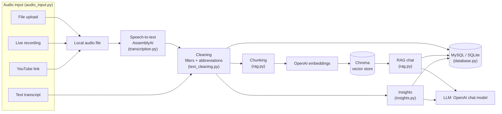
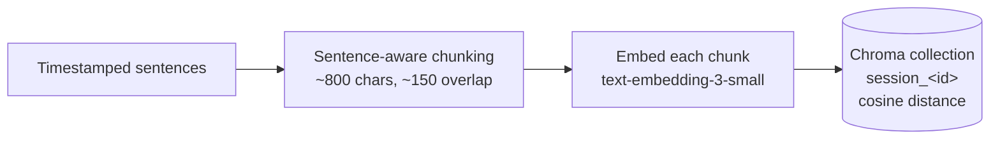
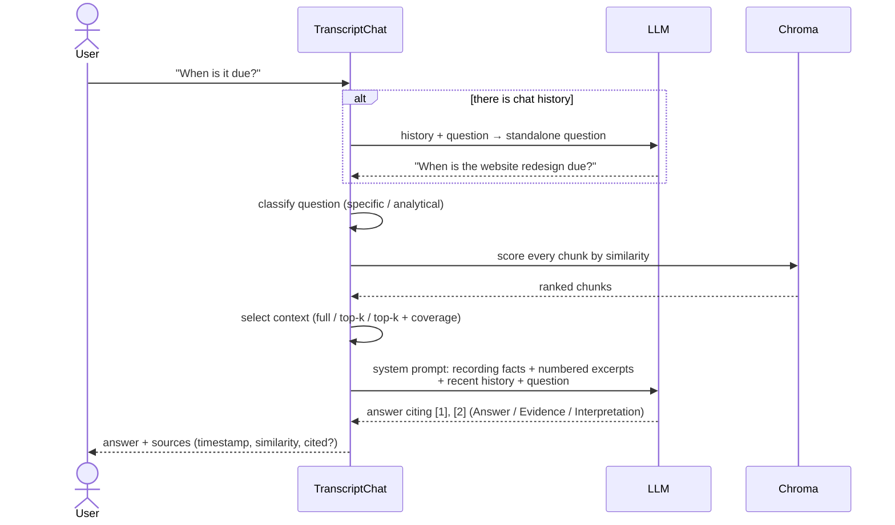
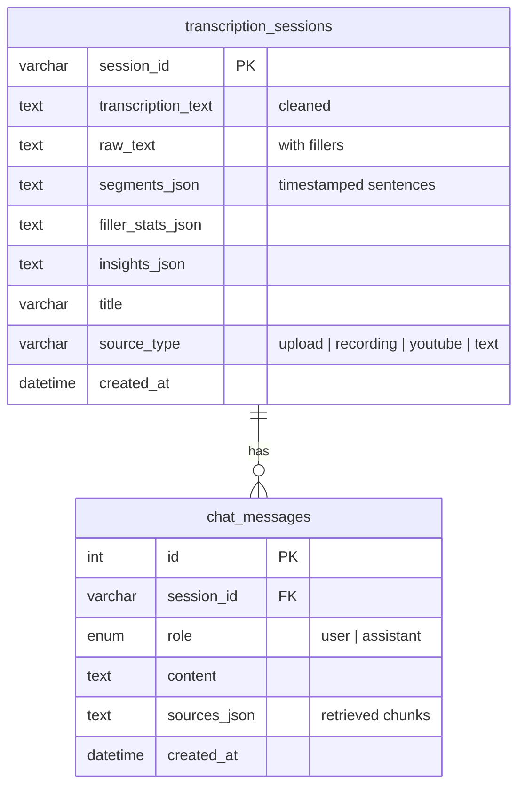

# VoxAuraAI — Architecture and RAG Workflow

This document explains how VoxAuraAI works and why it is designed this way. It
is written for the academic evaluation of the project.

## 1. Overview

All four input methods produce the same thing, either an audio file or plain
text. From that point on they share **one pipeline** (`pipeline.py`). The four
separate apps of the earlier version each had their own copy of this logic.

### Module responsibilities

The `voxaura` package is split into layers:

| Module | Responsibility | Depends on Streamlit? |
|---|---|---|
| `config.py` | Reads settings from environment variables / `.env` | No |
| `ingestion/audio_input.py` | Saves uploads and recordings; downloads YouTube audio | No |
| `ingestion/transcription.py` | AssemblyAI REST client: upload → request → poll → sentences | No |
| `ingestion/transcript_files.py` | Validates and parses text and subtitle transcripts | No |
| `analysis/text_cleaning.py` | Filler detection and removal, abbreviation expansion | No |
| `analysis/rag.py` | Chunking, vector index, retrieval, grounded answer generation | No |
| `analysis/insights.py` | Summary, key points, action items (direct or map-reduce) | No |
| `database.py` | Sessions and chat history in MySQL or SQLite | No |
| `report.py` | PDF export of the insights | No |
| `pipeline.py` | Orchestrates the modules above | No |
| `ui/pages.py`, `app.py` | Streamlit interface | Yes |

Only the UI layer imports Streamlit. This keeps the AI logic testable on its
own: the test suite drives the pipeline directly, without a browser.

## 2. Processing pipeline

`VoxAuraPipeline.process_audio()` runs these steps:

1. **Transcribe.** The audio is uploaded to AssemblyAI and a transcript is
   requested with `disfluencies: true`. By default AssemblyAI removes "um" and
   "uh" itself; we keep them so the app can **detect and measure** them. The
   client polls until the job completes, with a timeout, then fetches the
   transcript split into **sentences with start/end timestamps**.
2. **Clean.** `TextCleaner` counts fillers in the raw text (for the fluency
   statistics), then cleans each sentence:
   * *Hesitations* (`um`, `uh`, `erm`) are always removed.
   * *Discourse markers* are removed only where a **context rule** says they
     are fillers. Each phrase in `config/fillers.json` names its rule, and
     each rule looks at the word before, the word after, and nearby
     punctuation:

     | Rule | Phrases | Filler | Not a filler |
     |---|---|---|---|
     | `like` | like | "So like we should", "I was like really tired", "like 20 people", "It was, like, huge" | "I like pizza", "looks like rain", "It's like a dream" |
     | `you_know` | you know | "And you know I felt", "It was hard, you know?" | "Do you know the answer?", "You know what happened?" |
     | `i_mean` | I mean | "I mean it was okay", "I mean, the…" | "I mean what I say", "I mean it." |
     | `hedge` | kind of, sort of | "it was kind of good" | "this kind of car" |
     | `clause_start` | basically, so yeah… | "Basically we need…" | "it's basically done" |
     | `comma` | actually, well, honestly… | "Actually, the…" | "Well done!", "as well" |
     | `edge` | I guess, I suppose | "It was okay, I guess." | "I guess so" |
     | `clause_end` / `tag` | or something, right | "snacks or something.", "…, right?" | "That's right." |

   * *Repeated words* ("the the", "I I") keep one copy; genuine doubles such
     as "that that" or "bye bye" are listed as allowed.
   * The commas around a removed filler go with it ("were, um, better" →
     "were better"), and each sentence is re-capitalised.

   The rules were checked against a real AssemblyAI transcript of speech full
   of fillers (`test_real_assemblyai_output_is_cleaned`).
   * *Chat shorthand* (`idk`, `btw`) is replaced. One- and two-letter keys
     (`u`, `k`) must be lower-case, and ALL-CAPS words are never treated as
     shorthand, so "ATM" and "Vitamin K" are safe.
   * *Acronyms* (`AI`, `NHS`, `U.S.`) are matched case-sensitively, so "US" is
     the country and "us" is a pronoun. They are explained on first use, for
     example "AI (artificial intelligence)", which also helps a search for
     "artificial intelligence" find the passage.
   * Every pattern refuses to match next to letters, dots, hyphens, apostrophes
     or "&", so "um" never matches in "umbrella", "uh" in "uh-huh", or "U" in
     "U.S." / "R&D".
3. **Save.** The session is stored with the cleaned text, the raw text, the
   timestamped sentences and the filler statistics.
4. **Index.** The transcript is chunked, embedded and stored in Chroma (see
   section 3).

5. **Insights.** A summary, tone, key points, action items and suggested
   questions are generated (section 4). If this step fails, the session is
   kept and a warning explains how to retry.

Text transcripts skip step 1. `transcript_files.py` checks the size, decodes
UTF-8, UTF-8-BOM, UTF-16 or cp1252, and rejects binary files or texts under 5
words. SRT/VTT subtitle cues keep their timestamps; plain text is split into
sentences and line breaks. Live recordings are checked for length and silence
(`check_recording`) before anything is uploaded.

### Responsiveness

Earlier, every rerun drew all four tabs, which made switching sessions slow.
Several changes fix this:

* Only the active page is drawn.
* The sidebar session list is cached in `st.session_state` and refreshed only
  when it changes.
* MySQL connections come from a small pool.
* Each session's chat object (its Chroma handle and recording facts) is built
  once and reused.
* A loading message appears before the heavy AI libraries are imported, and
  every slow step shows a spinner or progress bar.

## 3. The RAG workflow

### 3.1 Indexing (once per recording)

**Chunking (`chunk_segments`).** Sentences are added to a chunk until it would
exceed `CHUNK_SIZE` characters. When a chunk is full, its last sentences (up to
`CHUNK_OVERLAP` characters) are repeated at the start of the next chunk.

* *Why sentence-aware?* A fixed character split can cut a sentence in half,
  which damages both the embedding and the excerpt shown to the user. Grouping
  whole sentences avoids this. Sentences longer than a whole chunk are split on
  word boundaries as a fallback.
* *Why overlap?* An idea that spans a chunk boundary can still be retrieved
  from either side.
* *Why keep timestamps?* Each chunk records the start of its first sentence
  and the end of its last sentence. These time ranges become the **source
  references** shown with answers, for example `[2] 03:15–04:02`.

**Vector store.** Each session gets its own Chroma collection
(`session_<id>`), configured for cosine distance. Chunk index and timestamps
are stored as metadata. When a past session is reopened and its collection
already holds the right number of chunks, it is reused instead of being
embedded again, which avoids paying for the same embeddings twice.

**What goes in the vector store.** Only transcript chunks are stored. The
earlier version also embedded every chat message into the same store, so the
retriever could return the assistant's own earlier answers as if they were
evidence. Keeping the store transcript-only means every retrieved passage
genuinely comes from the recording.

### 3.2 Answering a question

#### Why plain top-k retrieval was not enough

In the first version every question used top-k similarity search. That works
for specific questions, such as "When is the deadline?", because the question
shares words and meaning with one passage. It fails for questions about the
recording as a whole. In testing on a real two-minute speech, "What is the main
topic of this recording?" scored only about 0.18 cosine similarity against
every chunk. The two chunks retrieved were effectively random, and the strict
prompt answered "I couldn't find that". Questions about tone, intent or
arguments have the same problem: the evidence is spread across the whole
recording, not concentrated in one passage.

#### Question routing and context selection (`classify_question`, `select_context`)

| Situation | Context given to the LLM | Reason |
|---|---|---|
| Transcript ≤ `FULL_CONTEXT_CHARS` (12,000 characters, about 3k tokens or 15 minutes of speech) | **All chunks, in order** | Nothing can be missed, and the cost is small. Retrieval scores are still computed and shown. |
| Long transcript, **analytical** question (tone, sentiment, style, intent, arguments, main topic, "why"…) | **Top-k chunks plus an evenly spaced coverage sample** across the recording | The answer has to reflect the whole recording, not one passage. |
| Long transcript, **specific** question | **Top-k chunks** (classic RAG) | Precise and cheap. |

The classifier is a transparent keyword rule, so it is easy to explain and to
test. Its decision and the chosen strategy are shown under every answer.

#### Evidence versus interpretation

The answer prompt asks for **Answer / Evidence / Interpretation** sections for
analytical questions:

* **Evidence** contains only short quotes or precise paraphrases with `[n]`
  citations, or *recording facts*.
* **Interpretation** must use hedged language and end with a confidence level.
* The model may not invent quotes, speakers or facts. It must say that it
  cannot hear the voice when tone matters, and it must cite at least one
  excerpt whenever it describes the recording.

**Recording facts** are measurements computed by the app, not by the LLM:
duration, words per minute, filler rate, and the distribution of AssemblyAI's
sentence-level sentiment. They give style and sentiment answers objective
evidence alongside the model's reading of the text.

#### Suggested questions

When insights are generated, which happens automatically after every input,
the same LLM call returns four questions specific to the recording. The chat
page shows them together with general analytical questions. They stay visible
after each answer, and questions already asked are left out. Clicking one
uses a button callback that queues the question for the next run, so it is
always answered.

1. **Question rewriting (condensing).** A follow-up such as "when is it due?"
   retrieves poorly on its own, because "it" matches nothing in the
   transcript. When there is earlier conversation, the LLM first rewrites the
   question into a standalone search query. The first question of a
   conversation skips this step, which saves an LLM call. The UI shows the
   rewritten query so the step is visible.
2. **Retrieval.** The query is embedded and the `RETRIEVAL_K` most similar
   chunks are fetched. Similarity is calculated as `1 − cosine distance`.
3. **Grounded generation.** The retrieved chunks are numbered and placed in
   the **system prompt** with their time ranges. The model is told to use only
   these excerpts, to cite them as `[n]`, and to reply "I couldn't find that in
   the transcript" rather than guess. Temperature is 0.
4. **Sources.** The UI lists every retrieved chunk with its timestamp,
   similarity score and whether the answer cited it. These sources are saved
   with the message, so they reappear when a past session is reopened.

### 3.3 Keeping chat history and retrieved content separate

The prompt has two clearly separate inputs:

| Input | Where it goes | Used for |
|---|---|---|
| Retrieved transcript chunks | System message, numbered `[1]…[k]` | The evidence the answer must be based on |
| Chat history (last 4 turns) | Separate human/AI messages | Understanding follow-ups and conversation questions ("what did I ask first?") |

History is never embedded, never stored in the vector database, and never
mixed into the "Transcript excerpts" block. The test
`test_follow_up_is_rewritten_and_history_kept_out_of_context` checks this.

## 4. AI insights

`generate_insights()` asks the LLM for a JSON object with `title`, `summary`,
`key_points`, `action_items`, `tone` and `suggested_questions`.

* **Short transcripts** (≤ 24,000 characters, about 6k tokens) are sent in a
  single call.
* **Long transcripts** use **map-reduce**. The chunks are grouped into
  sections, each section is condensed into notes in parallel (map), and the
  notes are combined into the final insights (reduce). Every request then
  fits in the model's context window, whatever the length of the recording.

The JSON is parsed defensively: code fences are tolerated, missing fields
default to empty, and a clear error is shown if the model does not return
JSON. The generated title replaces the file name in the session history.

**PDF export** (`report.py`) lays out the insights with ReportLab: KPIs,
summary, tone, key points, action items, filler and sentiment bars, and
suggested questions, with an optional transcript appendix. Every page has a
footer stating that the content is AI-generated.

## 5. Data model

The schema extends the two tables from the earlier version instead of
replacing them. Missing columns are added on start-up, and sessions saved by
the old app still open: they are re-chunked from their plain text without
timestamps.

Vectors live in Chroma (`data/vectorstore/`), not in MySQL. The relational
database holds the records, and the vector database holds the search index.

## 6. Design decisions and trade-offs

| Decision | Reason | Alternative considered |
|---|---|---|
| AssemblyAI REST API via `requests` | The upload, request and poll steps are visible and easy to explain | AssemblyAI SDK (hides the steps) |
| One Chroma collection per session | Simple isolation, no metadata filters needed, easy to delete | One shared collection filtered by `session_id` |
| Sentence-aware chunking (own implementation) | Keeps timestamps and never splits sentences | LangChain `RecursiveCharacterTextSplitter` (no timestamps) |
| LangChain LCEL (`prompt \| llm \| parser`) | Short, readable chains; easy to swap in a fake model for tests | `ConversationalRetrievalChain` (deprecated, mixes memory and retrieval) |
| SQLite fallback | The demo works without a database server | MySQL only |
| `gpt-4o-mini` default | Low cost, fast, good enough for grounded Q&A; configurable | Larger models |

## 7. Evaluating the RAG system

Ways to evaluate the system during a demonstration or viva:

* **Groundedness:** ask something the recording does not mention. The expected
  answer is "The recording doesn't seem to mention that."
* **Analysis quality:** ask about tone or intent. Check that every *Evidence*
  bullet is a real quote with a correct citation, and that the
  *Interpretation* is hedged and gives a confidence level.
* **Retrieval quality:** check that the cited chunks in *Sources* contain the
  answer, and look at their similarity scores.
* **Follow-ups:** ask "who said that?" or "why?" after a question and check
  the *Searched for:* caption.
* **Parameters:** change `CHUNK_SIZE`, `CHUNK_OVERLAP` and `RETRIEVAL_K` in
  `.env`, then compare answers for the same questions. Smaller chunks give
  precise but narrow context; larger chunks give more context but more noise.

Possible extensions: speaker diarisation (AssemblyAI `speaker_labels`) as chunk
metadata; hybrid keyword and vector search; questions across several sessions;
an automatic evaluation set of question/answer pairs.
